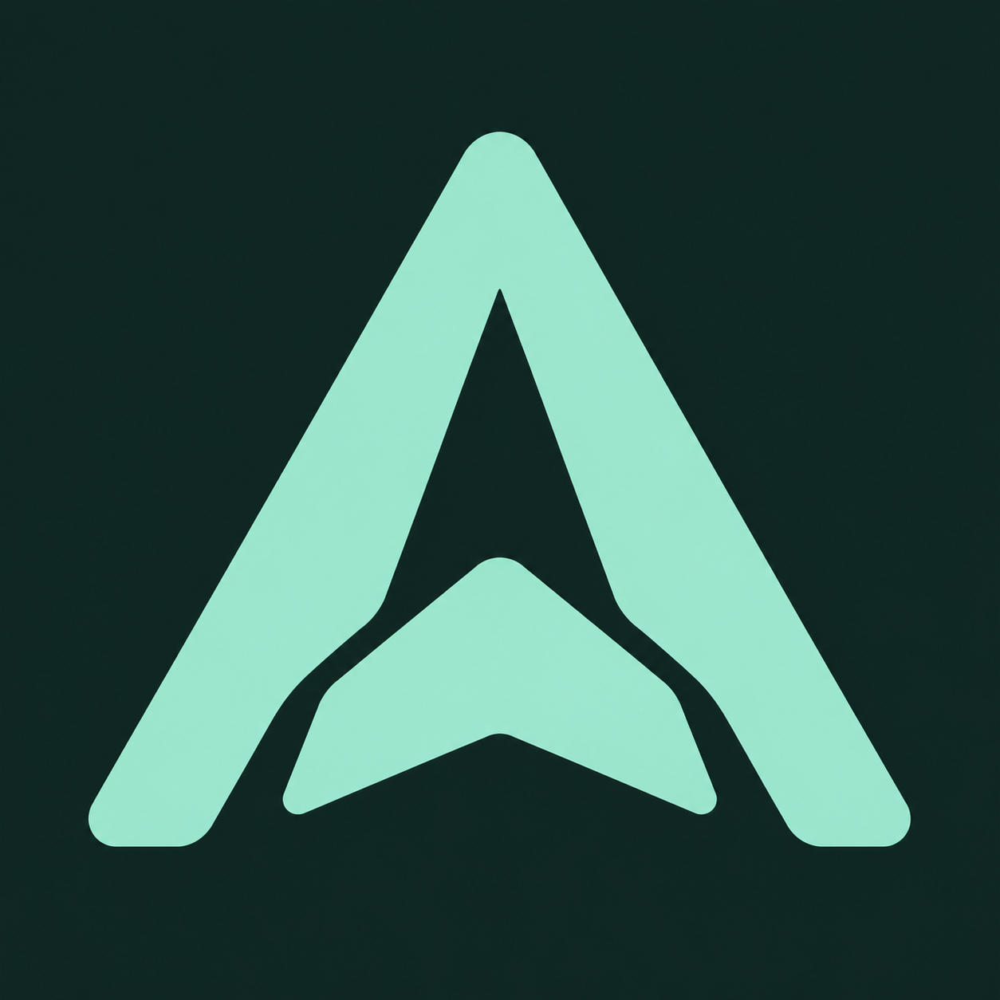
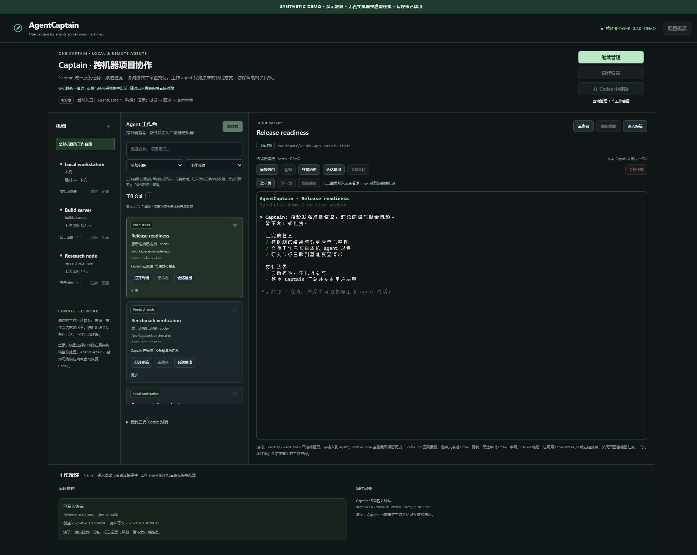

<div align="center">
  <p></p>
  <h1>AgentCaptain</h1>
  <p><strong>One captain for agents across your machines.</strong></p>
  <p>Delegate, coordinate, and supervise local and remote coding agents through one lead conversation.<br>Set the goal, let your lead agent follow the work, and keep the final say.</p>
  <p>
    <a href="https://github.com/jiale-wangOwO/agent-captain/actions/workflows/ci.yml"></a>
    <a href="LICENSE"></a>
    <a href="docs/guides/operator-guide.md#requirements"></a>
    <a href="docs/guides/operator-guide.md#requirements"></a>
  </p>
  <p><a href="README.zh-CN.md">中文</a> · <a href="#get-started">Get started</a> · <a href="docs/index.md">Documentation</a> · <a href="CONTRIBUTING.md">Contribute</a> · <a href="SECURITY.md">Security</a></p>
</div>



*A demonstration of the workbench using synthetic machines, sessions, and activity—not a recording of live workers or verified project results.*

[Reproduce the offline demo →](docs/guides/visual-demo.md)

## Less window switching. More direction.

Coding agents can work across several projects and machines. AgentCaptain gives that work a shared management layer without replacing the terminals you already use.

| You need to… | AgentCaptain helps you… |
|---|---|
| Understand progress across machines | Ask one Captain for relevant updates, blockers, and decisions. |
| Turn an objective into coordinated work | Delegate to workers, clarify context, follow up, and review delivery evidence. |
| Stay close to an individual project | Open its real shared terminal and talk to the worker directly. |

The **Captain is the model in a native local Codex conversation**, initialized with its management role and tools. Workers do the engineering; the Captain asks the relevant worker when it needs domain context, coordinates the work, and reports back. **You retain final authority.** There is no additional hosted model service.

## Your workbench

- **Local + SSH.** Configure machines in the UI and open terminals in a chosen project directory. External tunnel adapters may supply an ordinary SSH endpoint.
- **Connected means manageable.** Registered open shared workers join the management view automatically. Name, search, filter, and pin them without an activation checklist.
- **Actual conversation output.** Read an exactly associated Codex session, including paginated long replies. A terminal's visible report tail is not treated as the full report.
- **Human-first interaction.** Shared terminals preserve direct access and protect human drafts. Uncertain submissions keep their original delivery identity rather than being blindly resent.
- **Timing with context.** Message cards separate creation from confirmed terminal write; machine cards show passive SSH response observations, not ping or proof of task progress. See [how to read these indicators](docs/guides/operator-guide.md#message-times-and-ssh-response).
- **Explicit recovery.** Reconnect an original persistent terminal without silently creating a replacement, resuming a model, or replaying tasks.

## Get started

### 🤖 Let your agent set it up

If you have a coding agent (Claude Code, Cursor, Codex, whatever), you don't need to read the rest of this file. Just say to it:

```text
Please install https://github.com/jiale-wangOwO/agent-captain and get it running
on this computer. Follow its README and operator guide, and verify the local workbench.
Help me start my first management session using my existing Codex setup, then ask which SSH
machines and project folders I want to add. Preserve existing settings and sessions;
leave login, passwords, trust and approval prompts to me.
When ready, give me the URL and a short guide to connecting workers,
chatting with them directly, and delegating tasks through the lead agent.
```

Any coding agent can help with installation; the Captain itself currently runs in local Codex. Repository access and any required sign-in or approvals still need your participation.

### Manual setup

You need **Python 3.11+**, **Node.js 22+**, npm, and a configured local **Codex CLI**. Remote workers additionally need Linux, OpenSSH, Python 3, tmux, and Codex for that remote user. See the [complete requirements](docs/guides/operator-guide.md#requirements).

```sh
git clone https://github.com/jiale-wangOwO/agent-captain.git agent-captain
cd agent-captain
npm ci
python scripts/captain.py serve
```

Open **[localhost:8766](http://127.0.0.1:8766/)**. The repository currently remains **private**; cloning requires access. A fresh installation contains only your local machine.

On Windows, `run_agentcaptain.cmd` starts the per-user background service and opens the workbench. For explicit background operation, use `python scripts/captain.py service start` and `python scripts/captain.py service status`. No administrator service or automatic startup is installed.

Prefer an installed command? Run `python -m pip install -e .` in this checkout, then use `agent-captain serve` or `agent-captain service start`. Keep the checkout and its npm dependencies available; this is not a self-contained desktop installer.

1. **Connect work.** Add an SSH alias if needed, choose a project folder, and open a terminal. Start `codex`, `codex-switch`, or your usual launcher yourself.
2. **Start your Captain.** Choose **Start management session**. The Hub prepares a dedicated local Codex conversation with its role, identity, and tools. Complete any sign-in, trust, or permission prompts yourself; no manual plugin installation is required for this path.
3. **Give it an objective.** Already connected workers join automatically. Optional creation settings let you choose where the Captain may create new workers; creation is disabled by default.

Try a read-only first request:

> Check the connected workers' latest session output. Summarize progress, supporting evidence, blockers, and decisions I need to make. Do not send new tasks yet.

Then delegate a bounded task:

> Ask the API worker to investigate the failing regression, implement a fix, and report its test commands, results, and remaining risks. Follow up with that worker if evidence is missing.

[Full setup and operation guide →](docs/guides/operator-guide.md)

## Important boundaries

AgentCaptain is **single-user, local-first, and Codex-focused**. Keep it on loopback; it is not a multi-tenant cloud control plane or a universal CLI automation framework. Management-session initialization and desktop transfer remain **experimental**, not certified across every Codex version or provider.

The Hub does not automatically wake a dormant model, accept approvals, or guarantee survival through sleep, shutdown, or network loss. It cannot seamlessly take over arbitrary terminals already running elsewhere. A task being **submitted** or a worker reporting **done** is not the same as verified completion.

Hub-created Captains have independent tool identities and explicit machine/project roots for **new-worker creation**. The [optional existing-chat integration](docs/guides/operator-guide.md#optional-connect-an-existing-codex-chat-with-the-legacy-plugin) uses a separate shared-service compatibility credential and does **not** enforce those independent creation-root limits. Neither mechanism is an operating-system sandbox. Read the [security model](SECURITY.md) before enabling tools.

## Find your next step

| Topic | Read |
|---|---|
| Setup, daily operation, and the optional existing-chat plugin | [Operator guide](docs/guides/operator-guide.md) |
| Session naming, shared terminals, history, and reconnection | [Agent workbench](docs/agent-workbench.md) |
| Delegation, acceptance, permissions, and manager lifecycle | [Management contract](docs/management-session-product.md) |
| Service failure, SSH routes, and Codex background packages | [Recovery and maintenance](docs/index.md#recover-and-maintain) |
| Tests, publication hygiene, and contribution workflow | [Contributing](CONTRIBUTING.md) |
| Source packages, component boundaries, and existing-installation migration | [Repository layout](docs/repository-layout.md) |

## Contribute

Focused bug reports, reproducible tests, and small pull requests are welcome from collaborators with repository access. Use synthetic fixtures; never attach real tokens, connection descriptors, session logs, or personal configuration. See [CONTRIBUTING.md](CONTRIBUTING.md) and [SECURITY.md](SECURITY.md).

MIT licensed. See [LICENSE](LICENSE) and [third-party notices](THIRD_PARTY_NOTICES.md). AgentCaptain is an independent project; OpenAI, Codex, and other third-party names belong to their respective owners.
