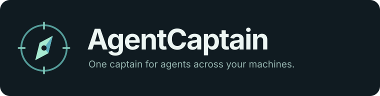

# AgentCaptain · 队长

<p align="center">
  
</p>

**One captain for agents across your machines.**

Manage local and remote coding agents through one lead agent. Your Captain turns goals into assignments, follows up with workers, reviews delivery evidence, and brings decisions back to you.

[中文说明](README.zh-CN.md) · [Agent workbench](docs/agent-workbench.md) · [Management-session design and limits](docs/management-session-product.md) · [SSH transport contract](docs/ssh-transport.md) · [Codex maintenance](docs/codex-maintenance.md) · [Security](SECURITY.md)

AgentCaptain is a single-user, local-first management workspace for coding agents on your computer and remote Linux machines. **Version 0.7 makes connected work automatically manageable:** name sessions directly on their cards or detail view, then coordinate registered workers across machines without activation switches or per-worker grant checklists. Search, filters, pinning, and safe reconnection remain available. The management-session MVP introduced in 0.5 creates a real local Codex conversation with its role, tools, and authenticated management identity initialized. That integration remains experimental; version-specific live integration and desktop transfer are not certified by the unit tests.

The **Captain is the model in that native Codex conversation**, acting as a domain-expert manager: clarify unfamiliar details with the responsible worker, break down and delegate objectives, follow up and correct gaps, review evidence, and summarize decisions. The workers do the actual engineering; the Captain does not default to bypassing them with its own SSH or code changes. The human retains final authority. AgentCaptain runs no separate model backend, does not change the workers' roles, and does not automatically wake a dormant conversation. Each worker still has a real terminal in which you can use your normal Codex workflow or talk directly.

## Why use it

- **One conversation instead of many windows.** Ask your Captain for progress and blockers across local and remote machines.
- **Delegate the management work.** Give an objective; let the Captain handle assignments, follow-up, coordination, and review within your instructions.
- **Keep evidence and delivery straight.** Read actual session output, distinguish a completion claim from verified results, and reconcile uncertain submissions before sending again.
- **Stay close to the work.** Open any worker's real terminal and talk directly whenever you want.
- **Keep the final say.** You set priorities and boundaries; consequential decisions, sign-in, trust, and approvals remain yours.

## What it does

- Connects local terminals and SSH machines configured in the UI.
- Creates and restores one default local management conversation, using an exact native Session ID rather than a newest-file guess.
- Prepares a dedicated management workspace, persistent role guidance, and an independently authenticated MCP tool connection without manual plugin installation.
- Opens a shell in a selected project directory, or the user's home directory.
- Lets the human and controller read and write the same worker terminal.
- Automatically includes all registered open shared workers, including temporarily disconnected original terminals; separately limits new-worker creation by Hub-created managers to explicitly chosen machine/project-directory roots. Startup does not scan every machine or history.
- Reads persisted output from an exactly associated Codex session, including paginated long messages and optional tool records.
- Preserves delivery identity across uncertain submissions and gives human typing priority.
- Keeps terminals independent of the browser and Python UI service.
- Uses standard SSH aliases, including aliases backed by an external tunnel adapter.

This is **Codex-focused**, not a universal CLI automation framework, a multi-user control plane, or a hosted cloud service. It does not seamlessly take over arbitrary terminals already running elsewhere.

## Requirements

| Where | Requirements |
|---|---|
| Control computer | Python 3.11+, Node.js 22+, npm, a modern browser |
| Local workers | An installed Codex CLI and the user's normal authentication/provider setup |
| Remote workers | Linux, OpenSSH access, Python 3, tmux, and Codex installed for the remote user |
| Hub-created manager | A configured local Codex CLI supporting `exec --json`, exact-session `resume`, and stdio MCP |
| Optional existing-chat plugin | A local Codex client supporting plugins and stdio MCP |

The Python service uses the standard library. Terminal dependencies are installed with npm; browser assets are served locally, without a CDN. A native-build toolchain may be needed if `node-pty` cannot use a prebuilt binary.

## Quick start

```sh
git clone https://github.com/jiale-wangOwO/agent-captain.git agent-captain
cd agent-captain
npm ci
python app.py serve
```

Open [http://127.0.0.1:8766/](http://127.0.0.1:8766/). The repository is private, so cloning requires GitHub access.

On Windows, `run_agentcaptain.cmd` starts the per-user service in the background and opens the UI. For explicit background operation:

```sh
python service.py start
python service.py status
```

On Windows, the background launcher uses a hidden, current-user WMI process factory so the web service and terminal broker outlive a temporary launching tool. Private, one-shot launch plans, actual-process identity receipts, and exit logs are stored under `.runtime/background-launches/`. Launch uncertainty is reported explicitly, with no automatic retry or fallback into the launching tool's process lifetime. This does not make the services immune to Windows shutdown, sleep, or network loss. See [background service lifecycle](docs/background-service.md) for diagnostics and recovery boundaries.

No administrator service or automatic startup is installed. A fresh configuration contains **only the local machine**. Add remote machines yourself in the UI, using a generic SSH alias such as `dev-workstation`; credentials remain in your existing SSH setup.

## Start your management conversation

1. Configure and connect the workers below. Registered open shared workers automatically become manageable, including original terminals whose display is temporarily disconnected. No historical discovery runs automatically; you may create the manager before connecting any workers.
2. Click **Start management session** on the home card. Keep the default name or choose one; there is no worker checklist. Creating additional workers is disabled by default; optionally choose a connected machine and a concrete project directory using the directory chooser. Those roots control new creation only, not access to existing workers.
3. The Hub prepares its own management workspace and MCP connection, then runs a one-shot, **read-only** native Codex initialization. It obtains the Session ID from the owned launch's native JSON event and asks only for `get_controller_context`. No worker task, history read, or new worker is part of initialization.
4. Continue in the real management terminal. **Ready** requires both exact identity and an authenticated tool handshake, together with a usable terminal; a PID, visible welcome message, or connected PTY alone is not enough. Complete required login, trust, or permissions yourself. Provider and authentication settings are not rewritten.
5. Thereafter use **Continue management**, which restores the original conversation. Use **Management settings** (「管理设置」) to change the optional new-work project roots. Existing and subsequently connected workers join automatically. Repeated clicks, refreshes, and uncertain responses retain the original operation and do not force a second manager.

For this workflow, **do not manually install the legacy plugin**: the Hub-generated manager already receives its identity-specific tool configuration. Before starting, make sure your local Codex installation and normal account/provider setup work. If initialization fails or its outcome is unknown, inspect the reported phase and original identity; the Hub does not delete locks, fork, or restart the shared Codex background server to conceal an error.

New management workspaces are outside the source checkout: `%LOCALAPPDATA%/AgentCaptain/management-workspaces/<controller-id>` on Windows, or `$XDG_STATE_HOME/agent-captain/management-workspaces/<controller-id>` (default `~/.local/state/...`) on Linux/macOS. Already registered workspaces retain their exact saved paths; renaming the product does not move them. This avoids trusting the whole repository just to enter a Captain. Codex may still require you to confirm trust for that new owned directory; AgentCaptain never accepts this prompt for you.

The first self-check inherits your model/reasoning settings and can take several minutes. Its asynchronous launch remains visible; the Hub does not switch models or start duplicates because it is slow. Initialization is bounded to ten minutes, preserving any verified Session ID for reconciliation and exact resume after a timeout.

Resume retains the witnessed local Codex executable entry, instead of resolving a different version from a new shell's `PATH`. If that installed entry is removed, restoration stops with an environment error; it does not silently downgrade to another CLI or alter your provider setup.

For future owned management processes on Windows, existing proxy environment variables always win. If none are supplied, the Hub can inherit an explicitly enabled static, credential-free loopback HTTP(S) proxy from the user's Windows settings. PAC, auto-detection and non-loopback proxies are not guessed. This changes neither global networking nor worker processes; localhost Hub/MCP/broker traffic still bypasses proxies. It improves launch-context compatibility, not a guarantee against model-service retries or timeouts.

Use Hub controls to restore this managed conversation. The MVP does not track arbitrary in-terminal `/new` or `/resume` switches: its Session field is the verified managed identity, not a promise to follow a manually replaced conversation. Do not switch native conversations inside this management terminal.

For example:

> Read the authorized slides and server workers, summarize actual progress and evidence, and list decisions I need to make. Do not send new tasks yet.

> Send this fix request to the authorized server worker, then summarize its result and verification.

### Manage an objective, not every message

Giving the manager an objective authorizes relevant investigation, questions to the responsible worker, delegation, clarifications, follow-up, corrections, and collection of acceptance evidence within that scope. You do not need to approve each ordinary management message again. A read-only request remains read-only; a materially expanded goal, a new permission boundary, or an unrelated destructive/external action still requires your decision. Login, secrets, trust and worker approval prompts remain yours, and new-worker creation by Hub-created managers still requires configured machine/project roots.

The manager first reads the selected worker's latest actual conversation output and existing delivery state, rather than scanning every machine or redispatching work already in progress. If it lacks domain context, it asks that worker for the authoritative source, current revision, relevant failures and next steps. It then sends normal user-style tasks or questions with a clear objective and acceptance criteria—no hidden management protocol or worker role change. Repository investigation, implementation, tests and PR-state checks belong to the worker; the manager reviews the results and requests missing evidence or rework. Platform maintenance is a separate engineering role only when you explicitly ask to fix the Hub or its connection tooling.

Reports distinguish **submitted**, **working**, **reported / awaiting acceptance**, **verified**, and **blocked**. A written input or a worker's completion claim is not verified completion: the report needs the applicable specification/revision, test commands and results, artifacts and remaining gaps. If you designate the latest specification as authoritative, the worker must verify that upstream revision rather than assume an expected fix has landed. See the [management contract](docs/management-session-product.md) for the full loop and boundaries. Follow-up here does not imply automatic background model wake-ups or an unattended scheduler.

### Continue in the Codex desktop app (experimental)

**Continue in Codex** requires you to confirm that the manager is idle with no unsent draft. The Hub checks its owned terminal, releases that input entry, and offers a `codex://threads/<exact-session-id>` link for the same saved conversation. It does not create a new chat or automatically send `/app` or another command.

The resulting status is **`desktop_unverified`**, not a verified seamless handoff. Opening a link does not prove the desktop app acquired the conversation or reloaded its identity-specific tools, project trust, model, and provider. Inspect those in the desktop app yourself; the Hub stops writing while the desktop owns the entry. To return, close the other entry and use **Continue management**, which attempts the same exact Session ID without reinitializing or resending business tasks. Occupancy and configuration errors remain explicit.

## Connect your workers

The workbench defaults to open shared work sessions across machines, including temporarily disconnected original terminals, while closed records are hidden. Choose all registered records to find legacy history entries. Filter by machine, status, name, or project path, and pin recurring work. **Name / Rename** is directly available on each card and in the selected session's detail view; it persists the same display alias used by Codex tools, without changing the native Codex title, Session, terminal ID, or process. Rename drafts survive polling and target changes. New-terminal names are optional: an unnamed creation uses its machine and project-directory leaf as a default, and cards retain the machine, path, and ID for disambiguation. Open a shared terminal, read actual conversation output, or reconnect directly from its card. Filtering, pinning, renaming, and changing the display do not start models or send task input.

Reconnection only reattaches the original remote persistent terminal. It must not create a replacement shell, run `codex resume`, or replay a task. If that terminal no longer exists, a local process cannot be restored, or the SSH route is unavailable, the service reports an actionable next step. Start new work explicitly. An external tunnel adapter remains responsible for restoring its SSH endpoint; the Hub does not restart shared tunnels or models. See the [workbench contract](docs/agent-workbench.md).

1. Select or configure a machine, then open a terminal. Use the directory chooser, enter an absolute directory on that machine, or leave it blank and `cd` from the home directory.
2. In that terminal, run `codex`, `codex-switch`, or your usual launcher. The human handles provider selection, login, secrets, OTPs, and approvals.
3. To continue an existing conversation, use the on-demand history finder and follow the displayed `codex resume <session-id>` command yourself. Exit the original client first; opening another terminal is not a transfer of ownership.
4. The connected terminal is automatically manageable. Give it a recognizable name on its card or detail view, or leave the default. There is no additional activation or per-manager worker selection; foreground readiness, human drafts, login, and approval checks still govern whether a task can actually be delivered.

Workers and managers are separate records and terminal services. A manager is not registered as its own worker; authenticated tools reject manager-to-manager operations and recursive management creation. These are Hub API safeguards, not operating-system sandbox isolation.

## Optional: connect an existing Codex chat with the legacy plugin

This is a compatibility path for a chat you already run, not a required step for Hub-created management sessions. Both paths can manage the same registered open shared workers; neither requires a global activation list or a per-manager worker checklist. A Hub-created manager retains its independent authenticated identity, lifecycle, delivery records, and explicit new-creation directory settings. The identity-only `get_controller_context` tool is not available to legacy credentials. The existing-chat plugin uses a shared service credential and retains its compatibility creation channel; it does not enforce an independent manager's creation-directory roots. Prefer a Hub-created management session when you need those explicit directory limits. This compatibility channel does not authorize unrelated tasks or bypass human approvals; see [the security boundary](SECURITY.md#legacy-existing-chat-integration).

First prepare a **machine-local** marketplace from the repository root:

```sh
python scripts/configure_plugin.py
```

The script prints `marketplace_root` and installation commands. Register the printed root, not the source checkout:

```sh
codex plugin marketplace add "<printed marketplace_root>"
codex plugin add agent-captain@agent-captain-local
```

The generator only creates files. It does **not** install the plugin, edit Codex settings, read a service token, or restart anything. The generated MCP command uses the Python interpreter that ran the script, an absolute path to its retained bridge, and a non-secret reference to the checkout's service descriptor. If you move the checkout, regenerate the plugin configuration.

**Keep the generated directory** while the plugin is installed. Its default location is `.runtime/plugin-marketplace/`. To update or move the installation, generate a new directory and register/install from the new printed path:

```sh
python scripts/configure_plugin.py --output .runtime/plugin-marketplace-v2
```

Existing outputs are deliberately not overwritten. The repository's `agent-captain-source` catalog is an unconfigured, **skill-only** source template, not a connected service; do not install it as a substitute for the generated `agent-captain-local` marketplace. This integration is local, not an official public-directory listing or a cloud-accessible MCP service.

If tools do not appear in an existing chat, select the plugin in a new chat. Reload the Codex app only when necessary; installing a plugin does not replace the tool context of an already-running chat. See the [official plugin CLI reference](https://learn.chatgpt.com/docs/cli/reference) for client-side commands.

## Read output without guessing

The terminal screen is useful for checking the current foreground program, but **a visible report tail is not a full report**. The separate “Session output” view reads the exact associated Codex rollout.

Association uses bounded evidence from the selected terminal's process tree, held rollout, or an explicit resume selector. It does not choose the newest conversation in a directory. If the live session cannot be established, use “Associate session” and enter the Session ID from `/status` in that same worker yourself; association sends no worker input.

When reading through MCP:

- Follow `next_cursor` for older records or remaining chunks; use `after_cursor` for newly appended output.
- Inspect `content_complete`, `history_complete`, `has_more`, and `read_issues`. A partial page is not the full history.
- Enable `include_tools` for full tool records; default recent signals are bounded summaries.
- Treat `live_session_verified=false` as a selected/last-verified association, not proof of the current in-TUI session. Re-associate after `/new` or `/resume` when direct identity evidence is unavailable.
- Treat disconnected or closed-session records as historical evidence, not proof that the worker is online.

Long messages are chunked rather than silently clipped. Incomplete or malformed records are explicitly reported. Hidden analysis/reasoning is not exposed.

## Input and lifecycle safeguards

**Terminals support safe scrollback and paging.** Use the wheel, PageUp / PageDown, and Previous page / Next page / Back to latest in worker and management displays. Incoming output preserves the reading position. If an SSH/tmux outer alternate screen has no browser-local history, Terminal history opens a read-only snapshot of the exact pane's retained text. Complete Codex responses remain available through the precisely associated Conversation output. Scrolling never sends remote keys, mouse reports, or tasks. See the [terminal reading boundaries](docs/agent-workbench.md).

**0.6.1 adds explicit local display-service recovery.** If the web page is online but worker displays are disconnected, check the workbench's separate service status. When the bound owner is affirmatively offline, confirm **Restore display service**, then reattach only the selected original terminal. The equivalent maintenance commands are `python terminal_service.py status` and `python terminal_service.py recover --confirm`. Recovery never deletes the binding, restarts remote Codex, batch-restores other sessions, or replays tasks; a live PID, ambiguous endpoint, or changed ownership blocks replacement. See the [recovery boundaries](docs/agent-workbench.md).

Ordinary task messages use bracketed paste and Enter in the same foreground Codex terminal. They are not shell commands and are blocked at a shell, login prompt, approval screen, or recognized startup menu. Raw keys are reserved for terminal actions explicitly authorized by the human.

Human drafts take precedence: `human_busy` means the controller must not overwrite them. A `submitted` delivery proves bytes were written, **not** that Codex accepted or completed the task. Keep the same `request_key`, inspect `get_delivery`, and never blindly resubmit uncertain writes with a new key.

The UI provides copy/paste, local scrollback, directory selection, explicit screen refresh, and confirmed terminal close. Mouse-wheel scrolling never becomes worker input. Clipboard fallback does not add Enter, although pasted text may itself contain newlines.

Closing a page, changing selection, or closing the Python Hub does not stop the independent terminal broker. If the broker or control computer stops, local PTYs end. Remote Hub-owned tmux sessions can survive SSH display disconnections and be reattached; reconnect does not automatically resume Codex or resend a task.

**“Close terminal” is different:** after explicit confirmation it ends that terminal's shell/agent and, remotely, its owned tmux session. It does not close other or external sessions. If the result is uncertain, the UI does not claim success.

The management terminal is separate from worker terminals. **Hide display** or closing the browser sends no termination or draft input. **End management session** explicitly ends the manager's terminal process and disables its capability; it does not stop workers. Saved native identity and history are retained for an explicit same-session recovery.

## MCP tools

| Tool | Purpose |
|---|---|
| `get_controller_context` | Verify the independent authenticated management identity and new-creation settings; managers only |
| `list_active_agents` | Compatibility name: list all registered open shared workers, including temporarily disconnected originals; no activation filter |
| `update_agent` | Persist the worker's display alias or pinned order without changing Codex or terminal input |
| `reconnect_agent` | Safely reattach the exact original registered terminal, without new creation, resume, or task replay |
| `get_agent` | Inspect one terminal's connection and foreground state |
| `read_agent` | Read its exact-session output with pagination |
| `send_agent_message` | Deliver ordinary user task text |
| `send_terminal_input` | Send explicitly authorized raw terminal input |
| `create_agent` | Open a worker terminal; Hub-created managers are limited to their explicitly configured connected-machine/project-directory roots. The result automatically joins registered work |
| `get_delivery` | Reconcile a durable submission |
| `poll_events` | Read incremental registered-worker events |

Read, write, delivery lookup, and event tools authenticate their caller and operate on registered open shared workers, not arbitrary sessions or manager terminals. Worker membership is automatic, but connection/readiness checks, human-draft protection, closed-session rejection, and independent lifecycle checks remain enforced. Existing queued writes retain their original request identity; old unknown or revoked operations are not replayed by this migration. Creating new workers through a Hub-created manager requires its explicit machine/project-directory roots; the existing-chat plugin retains the separate compatibility channel described above. The service does not automatically approve worker actions, recursively create managers, or start a new controller turn.

## SSH and tunnels

Remote operation remains ordinary OpenSSH. An external tool such as TunnelTerm may expose a loopback SSH port or `ProxyCommand`; AgentCaptain does not import that tool or manage its login/window lifecycle.

Validate a **persistent display plus concurrent short SSH requests**, not just one successful banner or `ssh host true`. Keep host-key checking enabled. See [the SSH transport contract](docs/ssh-transport.md) for stdin, concurrency, resize, and disconnect requirements.

## Local data and compatibility

The service binds only to loopback. Browser mutations require a matching Host/Origin and an HttpOnly SameSite cookie. MCP uses a private local capability descriptor, rejects browser-Origin requests, and does not forward the token through proxies or redirects.

Machine configuration, registered workers and aliases, durable deliveries, management identities, new-creation roots, and operation identities are stored in `.runtime/hub.sqlite`. Legacy activation/scope metadata is retained for compatibility but no longer gates ordinary registered-worker management. Capability descriptors stay in the private runtime directory; production management workspaces use the per-user private location above. An explicitly supplied development/test runtime keeps its workspaces in that namespace. Each descriptor has an independent capability; the raw token is not put in a prompt, URL, or command-line argument. `config.example.json` and optional ignored `config.local.json` initialize a new registry; an existing saved registry takes precedence.

The web/MCP service shares `.runtime/service.json`, with explicit connection-file overrides retained. The private `.runtime/worker-terminal-reference.json` holds only the physical path to an existing worker broker descriptor, not its token. A verified default terminal-creation workflow records this reference exclusively; metadata reads do not create it. This avoids Windows packaged-app and ordinary-shell state namespaces appearing to be different machines. A broken or unreachable pinned owner fails closed and needs human repair; it never creates a second broker owner automatically. Work terminal processes remain independent of web-service restarts.

For an already-running older bridge, an explicitly registered private `.runtime/service-compatibility-references.json` may list existing standard legacy Hub descriptors. A service restart refreshes only same-endpoint, valid Hub-shaped targets so those same clients can follow token rotation. It does not discover destinations, copy account authentication, or touch different-port/non-Hub files. New installations use the canonical descriptor.

Each manager's workspace contains its own `AGENTS.md` and `.codex/config.toml`. Its identity-specific connection is also supplied explicitly when the Hub launches or resumes Codex, without changing the user's global configuration. Whether a desktop client loads the same project configuration and trust is part of the experimental transfer check, not an assumed guarantee. The Hub's API checks and creation-root limits do not restrict Codex's unrelated native tools, other plugins, or the user's SSH/system permissions.

Branding updates do not replace running workers, rewrite terminal or native Session IDs, or replay tasks. Existing installations retain their saved records and compatibility identifiers; see [rename and compatibility notes](docs/rebranding.md) before changing a deployment.

Browser key input is not saved in the delivery database. Terminal output may still contain secrets a user prints, and controller-submitted tasks/deliveries are local private data. Do not commit `.runtime/`, connection descriptors, authentication files, or personal configuration. This is not a multi-tenant security boundary; do not expose the service on the public network.

## Codex daemon maintenance

Updating the CLI does not necessarily update its separately managed shared background package. The optional Linux helper defaults to a read-only check:

```sh
python3 scripts/codex_sync_daemon.py --check
python3 scripts/codex_sync_daemon.py --sync --timeout 60
```

Run it **on the worker machine**, using the current user's trusted CLI installation. Any loaded session, including an idle one, blocks synchronization. It synchronizes from the current CLI, not an independently selected latest version. See [maintenance instructions and verification limits](docs/codex-maintenance.md) before using `--sync`.

## Development and tests

```sh
python -m unittest discover -s tests -v
node --check web/ui.js
node --check web/controller.js
npm run test:terminal
npm run test:ui
python scripts/check_publication.py
```

Real PTY/remote integration tests are opt-in and are not enabled by ordinary unit tests. Run them only against disposable sessions. Tests cover automatic registered-worker membership, alias persistence, explicit new-creation roots, native initialization events, stable start/resume keys, uncertain results, independent manager lifecycle, desktop-unverified UI, exact-session reads, durable delivery, human-draft protection, terminal rendering, and authentication. They do not certify every Codex version, provider, tunnel implementation, or desktop tool reload. The 0.5 management MVP remains experimental pending version-specific live validation.

See [CONTRIBUTING.md](CONTRIBUTING.md) for development and [SECURITY.md](SECURITY.md) for reporting concerns.

## License

AgentCaptain is MIT licensed. See [LICENSE](LICENSE) and [THIRD_PARTY_NOTICES.md](THIRD_PARTY_NOTICES.md). OpenAI, Codex, and third-party service names belong to their respective owners; this is an independent project.
